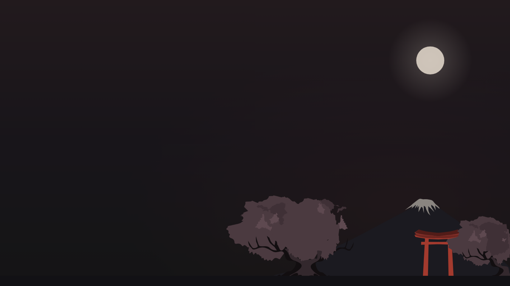
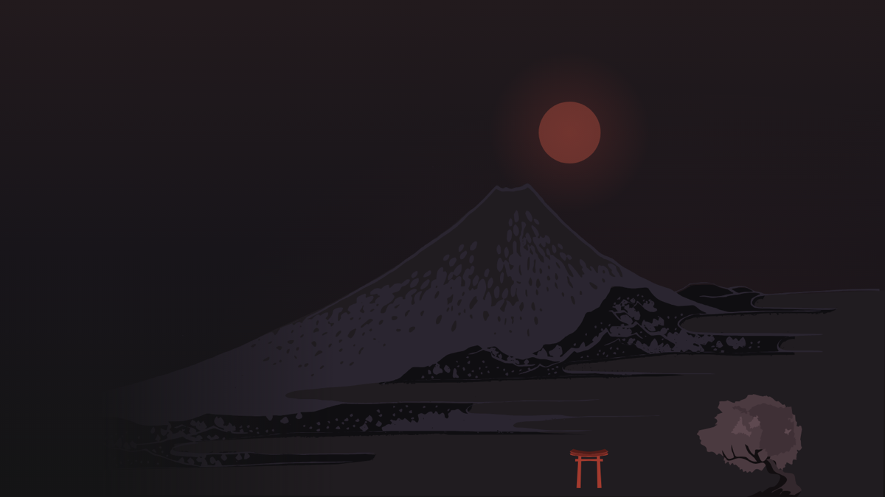
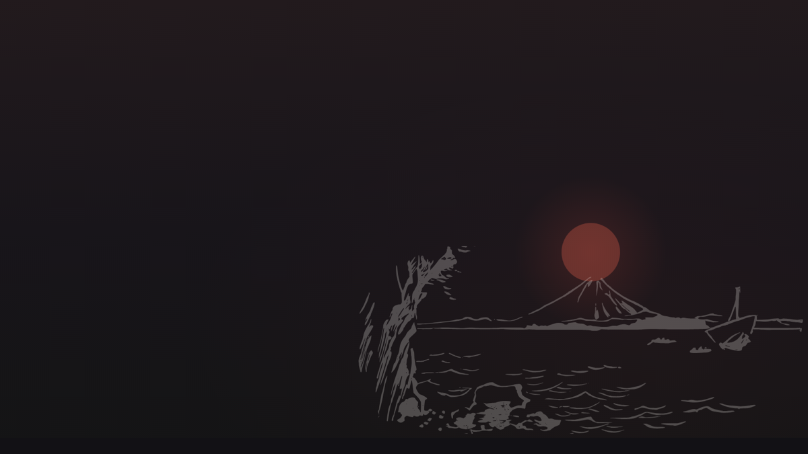
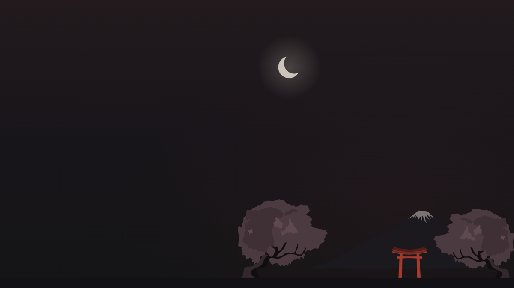

# samurai-night

A dark, quiet Japanese theme for [Claude Code](https://claude.com/claude-code):
ink-black surfaces, bone-white text and one vermilion accent, over four still
night scenes that change every 20 minutes.



## Features

- **Oni palette:** near-black surfaces (`#0e0e0f` to `#1f1f21`), warm bone text,
  a single vermilion accent. Dark mode only.
- **Four backdrop scenes,** kept to the lower right, clear of the text.
- **Rotation:** the scene changes every 20 minutes.
- **No CPU cost:** nothing animates and nothing is blurred.
- **`/scene` command** to switch by hand.

## Scenes

| `torii-dusk` | `red-fuji` |
| --- | --- |
|  |  |
| **`ink-sea`** | **`blossom-ridge`** |
|  |  |

## Install

At the prompt of a Claude Code terminal session:

```
/plugin install samurai-night --marketplace hotaru-ritsuki/samurai-night
```

Answer `y` to add the marketplace, then pick a scope (user scope applies it to
every session).

From a shell:

```bash
claude plugin install samurai-night --marketplace hotaru-ritsuki/samurai-night
```

In the desktop app: click **+** next to the prompt box, then **Plugins**,
**Add marketplace** with `hotaru-ritsuki/samurai-night`, then **Add plugin**.

## Usage

| Command | Effect |
| --- | --- |
| `/scene` | Switch to the next scene |
| `/scene <name>` | Switch to a named scene: `torii-dusk`, `red-fuji`, `ink-sea`, `blossom-ridge` |

## Uninstall

```bash
claude plugin uninstall samurai-night
```

## Project layout

```
.claude-plugin/
  plugin.json        mod manifest
  marketplace.json   makes this repo installable with one line
hooks/
  hooks.json         points at the hooks module
  register.tsx       palette, rotation, /scene command, backdrop renderer
  scenes.ts          the four scenes, composed from the artwork
  art.ts             recolored artwork (generated)
  make-colors.*      Claude Code's palette helper (vendored)
docs/screenshots/    scene previews
```

## Contributing

See [CONTRIBUTING.md](CONTRIBUTING.md). Changes are tracked in
[CHANGELOG.md](CHANGELOG.md).

## Credits

The scenes are built from three public-domain (CC0) SVGs on
[freesvg.org](https://freesvg.org), recolored: "Japanese landscape",
"Black and White Mountain Landscape Illustration" and "Mount Fuji".

## License

Code: [MIT](LICENSE). Artwork: CC0, from the sources above.
